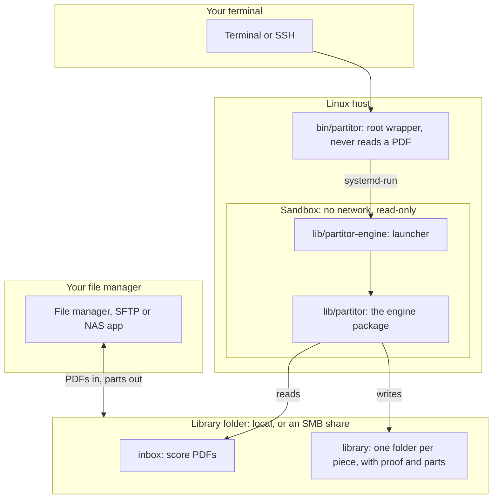
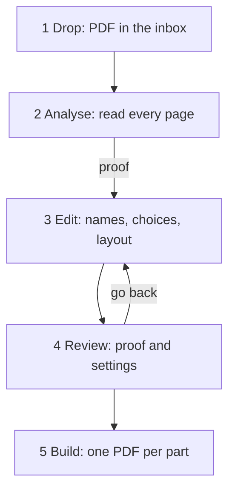
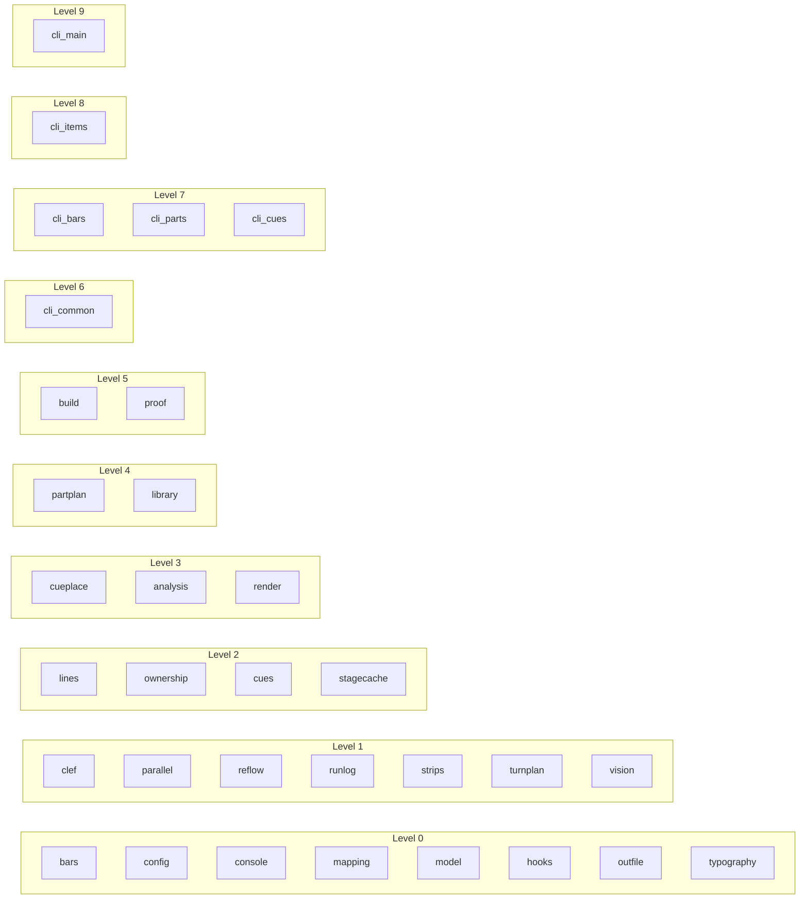
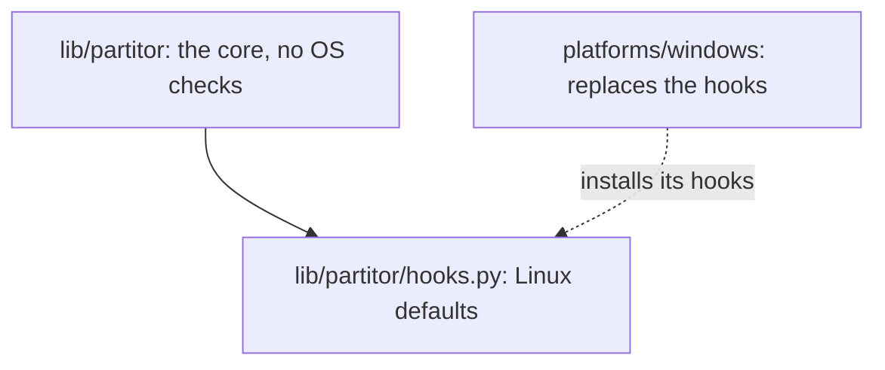

<!-- SPDX-License-Identifier: AGPL-3.0-or-later -->
<!-- Copyright (C) 2026 Nathan Wilkes and partitor contributors -->
# Architecture

How partitor is built and how a score becomes parts. The rules and algorithms are in
`docs/DESIGN.md`; this page is the map. It is checked against the code before every release.
Contributors: the diagrams follow the contract at the end of this page.

## The parts of a run

partitor is a command-line program. It has no web interface, no server and no network access.
On Linux you start the wrapper `bin/partitor` as root. The wrapper checks the paths and the
library folder and never reads a PDF. It starts the engine as the system user `partitor`, in a
sandbox (`docs/SANDBOX.md`). The engine reads score PDFs from the `inbox` folder of the library
and writes proofs and parts into the `library` folder.

The library layout is a stable contract (`docs/LIBRARY-LAYOUT.md`). Everything else in a piece
folder is internal.

## From score to parts

Five stages. You can go back from Review to Edit as often as you like. Nothing is built until
the last stage.

- **Analyse.** One raster pipeline reads vector and scanned pages alike: render, find staves and
  systems, give every ink component one owner, read labels and bar numbers (`docs/DESIGN.md` §4).
  Pages run in parallel workers, and a stage cache keeps the result of a page.
- **Edit and Review.** Your answers are saved in the settings of the piece and nothing is built.
- **Build.** The saved lines are packed into pages. Page turns decide the page count
  (`docs/DESIGN.md` §5). Each part also gets a large-print copy.

## The modules

The engine is the package `lib/partitor/`. Each module has a level. A module imports only
from a strictly lower level, so there is no cycle. The block below comes from `tools/modules.txt`.
The list of what each module owns is in `docs/DESIGN.md` §12.1.

<!-- BEGIN GENERATED: module-levels (tools/check-architecture.py --write) -->

<!-- END GENERATED -->

## Platforms

Linux is the primary system. The core in `lib/partitor/` has no operating-system checks. The few
things that differ (free memory, the console, the Tesseract path, the default library folder)
are hooks in `lib/partitor/hooks.py` with Linux defaults. A platform pack replaces them
(`platforms/windows/`). On Windows and macOS there is no wrapper and no sandbox: the engine runs
directly, so open only PDFs that you trust.

## Contract for the diagrams

The website draws each `mermaid` block itself, in the site colours. It reads this subset only:

- the first line is `flowchart TB` or `flowchart LR`;
- `subgraph ID["Title"]` ... `end` (they can nest);
- a node is `ID["Label"]`;
- an edge is `A --> B`, `A <--> B` (two arrows), `A -->|"text"| B`, `A -.-> B` (dotted) or `A ~~~ B` (no line, only order);
- a line that starts with `%%` is a comment.

Any other syntax fails the check in partitor and the build of the website. A path in the text
(`bin/partitor`) or at the start of a label must exist in the repository.
